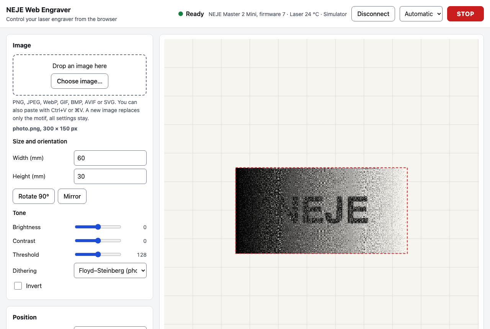

# NEJE Web Engraver

Control a **NEJE Master 2** laser engraver straight from the browser over USB. No install, no account,
works offline. Built and tested with a **NEJE Master 2 Mini**.



## Features

- **USB connection via Web Serial** in Chrome, Edge or Opera on Windows, macOS and Linux. A built-in
  **simulator** lets you try everything without a machine, in any browser.
- **Any image format.** PNG, JPEG, WebP, GIF, BMP, AVIF and **SVG**. SVG stays vector until it is
  rasterised at the machine's resolution. You can drag and drop anywhere on the page, paste from the
  clipboard or use the file picker.
- **Image tools:** size in mm, rotation, mirroring, brightness, contrast, threshold, Floyd–Steinberg
  or Atkinson dithering, and invert. A live 1:1 dot preview shows the result on a millimetre grid.
- **Positioning:** drag the image, use the arrow keys (1 mm steps, 10 mm with Shift), enter
  coordinates, or move the laser head to the image corner.
- **Safety:**
  - a confirmation dialog before every job, with explicit goggle and material checks,
  - a large **STOP** button and the **Esc** key,
  - a stop during an upload pads the remaining data with blank dots before cancelling.
- **History:** every job is saved with its image and all settings. Open an entry, reuse only its
  settings, or drop a new image in to swap the motif and keep everything else.
- **Material presets** (built-in starting points plus your own) and a rough job time estimate.
- **Head position:** after connecting, the head goes home (0, 0) and traces a 5 mm square with the
  laser off, so the app knows where the head is. The position is shown on the work area and kept up to
  date with every move. The Master 2 Mini has no limit switches, so home is where the head was when
  the engraver was switched on. Put the head in the top-left corner before you switch it on. The
  automatic check can be switched off, and **Go home** and **Test motion** are also available as buttons.
- **8 languages** (English, Čeština, Deutsch, Français, Español, Italiano, Polski, 中文). The app picks
  the browser language and offers a manual switch.
- **Accessible:** built to WCAG 2.2 AA and checked with axe in light and dark mode. It works with
  the keyboard alone and with screen readers.
- **Offline:** an installable PWA. After the first visit it runs without a network.

## Use it

1. Open the deployed app, or run it locally (see below), in Chrome or Edge.
2. Close the NEJE vendor app if it is running. Only one program can use the serial port.
3. Click **Connect engraver** and pick the USB serial port (`wchusbserial…` / `COM…`).
   - On Windows the [CH340 driver](https://neje99.com/faq/how-to-install-serial-driver.html) may be needed.

> [!WARNING]
> Laser light damages eyes and can start fires. Always wear laser safety goggles, never leave the
> machine unattended, and keep its power switch within reach. The software STOP is no substitute
> for it.

## Project status

| Area | Status |
|---|---|
| Connect, identify, telemetry, reconnect, homing, head moves | ✅ verified on a Master 2 Mini (automated hardware test) |
| Laser parameters | Sent to hardware without error; effect on burns not yet measured |
| Job upload and burn, trace frame, cancel | ✅ verified with a real calibration burn (traffic captured, see docs/PROTOCOL.md) |
| Pause/resume | Implemented to the vendor protocol, covered by simulator tests, not yet tried on hardware |
| Odd-row bit order | Two variants selectable (*Advanced*) until a calibration burn decides |
| Older KZ / BL / Master 1 boards (4-byte protocol) | Not supported |

The protocol is documented in [docs/PROTOCOL.md](docs/PROTOCOL.md).

## Development

Requirements: Node.js 22 or newer.

```bash
npm install
npm run dev        # http://localhost:3000
npm run check      # typecheck, lint, unit tests, build, end-to-end tests
```

| Script | What it does |
|---|---|
| `npm run build` | Static export to `out/`, deployable to any static host |
| `npm run preview` | Serves `out/` on http://localhost:4173 |
| `npm test` | Vitest unit tests: protocol bytes, parser, bitmap packing, dithering, session against the simulator, translations |
| `npm run test:e2e` | Playwright against the production build, including axe WCAG 2.2 AA scans, keyboard-only use, languages and offline mode |
| `npm run test:hardware` | Optional. Drives the real UI against a connected engraver, e.g. `NEJE_PORT=/dev/cu.wchusbserial3130 npm run test:hardware`. Its relay refuses anything that could fire the laser |

### Architecture

```
src/
  lib/protocol/   wire format, message decoding, bitmap packing, NejeSession (no DOM, fully unit tested)
  lib/transport/  Web Serial, simulator (real captured frames), Playwright hardware bridge
  lib/imaging/    file decoding (raster + SVG), dithering, rasterisation at device resolution
  lib/            job settings model + validation, history (IndexedDB), presets, storage
  i18n/           typed messages per locale, browser language detection
  hooks/ components/ app/   React UI (Next.js App Router, static export)
public/sw.js      offline service worker
```

- `NejeSession` exposes an immutable snapshot through `subscribe/getSnapshot`, so React reads it
  with `useSyncExternalStore`.
- All job settings are one validated object (`JobSettings`). History stores it next to the image,
  which is what makes swapping the motif possible.
- English is the source locale. TypeScript and the unit tests enforce that every locale has the same
  keys and placeholders, and that accessible names contain their visible labels (WCAG 2.5.3).

### Deploy

- **Vercel:** import the repository. No configuration is needed.
- **Any static host** (GitHub Pages, Cloudflare Pages, Netlify, nginx): `npm run build` and upload `out/`.
  For a sub-path, build with `NEXT_PUBLIC_BASE_PATH=/sub-path`.

Web Serial and the service worker need HTTPS, or `localhost`.

## Contributing

Issues and pull requests are welcome, especially:
- captures from other Master 2 models,
- results of calibration burns,
- translations.

Please run `npm run check` before opening a pull request.

## Disclaimer

This is an independent open-source project. It is not affiliated with or endorsed by NEJE
(Shenzhen ZhiXinJie Technology Co., Ltd.). The protocol was documented for interoperability with
hardware the author owns, and no vendor code or assets are included. Use at your own risk.

## License

[MIT](LICENSE)
