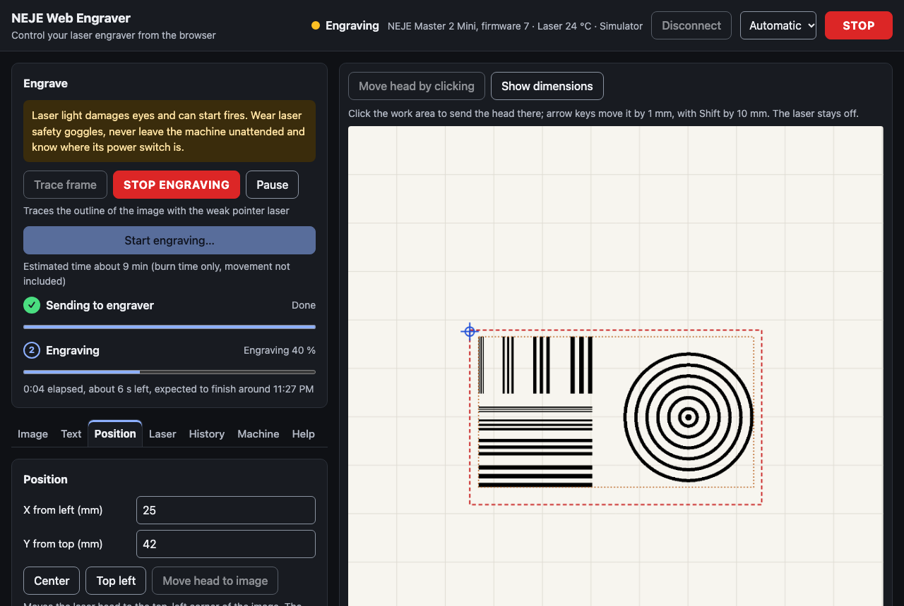

# NEJE Web Engraver

Control a **NEJE Master 2** laser engraver straight from the browser over USB. No install, no account,
works offline. Built and tested with a **NEJE Master 2 Mini**.


<details>
<summary>Dark mode</summary>



</details>

## Features

**Connection**
- **USB via Web Serial** in Chrome, Edge or Opera on Windows, macOS and Linux. A built-in
  **simulator** lets you try everything without a machine, in any browser.
- If the engraver goes silent, the app says so. The USB bridge keeps the port open even when the
  board is off or hung, so this cannot be detected any other way. Connection problems link straight
  to the **Help** tab.

**Engraving**
- The **Engrave** panel stays at the top: *Trace frame*, a red **Stop engraving** button, *Pause*
  and *Start*.
- **Two-phase progress.** The machine first receives the whole image and only then burns, so the
  panel shows two steps. *Sending to engraver* uses the receipt the device confirms. *Engraving*
  uses the device's own progress and clock. While it burns, the panel shows elapsed time, time left
  and the expected finishing time. Afterwards it shows "Finished at …, took …".
- **Safety:**
  - a confirmation dialog before every job, with goggle and material checks,
  - **STOP** in the header, in the panel and on the **Esc** key,
  - no command can reach the machine while image data is streaming,
  - a stop during the upload pads the rest with blank dots before cancelling.
- *Trace frame* follows only the area that will actually burn, with blank margins trimmed.

**Image, text and patterns** (tabs *Image* and *Text*)
- **Any format:** PNG, JPEG, WebP, GIF, BMP, AVIF and **SVG**. SVG stays vector until it is
  rasterised at the machine's resolution. Drop an image anywhere, paste it, or use the file picker.
- Size in mm, rotation, mirroring, brightness, contrast, threshold, Floyd–Steinberg or Atkinson
  dithering, and invert, with a live 1:1 dot preview on a millimetre grid.
- **Text tool:** type text, pick a font, bold or italic and alignment. It becomes a vector motif.
- **Test patterns** for focus, line widths and calibration, inserted at their calibrated size.

**Position and head** (tab *Position* and the work area)
- Drag the image, use the arrow keys (1 mm, or 10 mm with Shift), type coordinates, or centre it.
- **The head position is always visible**, as a crosshair and as text. It is known after *Go home*,
  updated with every move, and live while burning from the device's position reports.
- **Move head by clicking** on the work area, or with the arrow keys as a keyboard alternative.
- **Dimension lines:** image size and distances to the edges, head distances, and the head offset
  from the image corner. The values are also listed as text.
- The connection check after connecting (go home and trace a 5 mm square, laser off) can be
  switched off.

**Laser, machine and history**
- **Material presets:** NEJE's reference burning times (wood, bamboo, leather, acrylic …) and your own, plus a rough time estimate.
- **Machine settings**, stored in the engraver itself: pointer brightness when idle, motion-detection
  sensitivity, and motor speed (Slowest to Fast, as in NEJE's Windows software).
- **History** of every job, with its image and all settings. You can open an entry, reuse only its
  settings, or drop in a new image to swap the motif and keep everything else. The start dialog asks
  whether to save, and *yes* is the default.
  - History lives in this browser's IndexedDB. **Export** writes everything to a single JSON file
    for backup or for moving to another computer, and **Import** reads it back after validating it.

**Everywhere**
- **8 languages**: English, Čeština, Deutsch, Français, Español, Italiano, Polski, 中文. The app follows
  the browser language and has a manual switch.
- **Accessible:** built to WCAG 2.2 AA. axe checks every tab in light and dark mode, everything works
  with the keyboard alone, and it works with screen readers.
- **Offline:** an installable PWA. After the first visit it runs without a network.

## Use it

1. Open the deployed app, or run it locally (see below), in Chrome or Edge.
2. Close the NEJE vendor app if it is running. Only one program can use the serial port.
3. Click **Connect engraver** and pick the USB serial port (`wchusbserial…` / `COM…`).
   - On Windows the [CH340 driver](https://neje99.com/faq/how-to-install-serial-driver.html) may be needed.

> [!WARNING]
> Laser light damages eyes and can start fires. Always wear laser safety goggles, never leave the
> machine unattended, and keep its power switch within reach. The software STOP is no substitute
> for it.

## Engravings look shifted or blurry?

The software cannot detect this, because the steppers have no feedback. These are the usual causes:

- **Lines shift part-way through a job and stay shifted.** This happens with the vendor app too. The
  [NEJE manual](https://neje.wiki/doku.php?id=nejelaser_master_2_mini) says a loose belt causes image
  offset. Tighten the belt at its two adjustment points and check that the motor pulley's grub screws
  are tight. With the machine off, the head should move freely by hand along the whole axis. A slower
  **motor speed** (*Machine* tab) can also help.
- **Everything is blurry.** Set the laser 30–50 mm above the material (usually 40 mm) and turn the
  focus cap until the dot is as small as possible. The *Focus and resolution* test pattern shows the
  result.

## Project status

| Area | Status |
|---|---|
| Connect, identify, telemetry, reconnect, homing, head moves | ✅ verified on a Master 2 Mini (automated hardware test) |
| Laser parameters (power, burn time) | ✅ verified in real burns, stored by the device across power cycles |
| Machine settings: pointer brightness, motion detection | Implemented to the vendor protocol, not yet changed on hardware |
| Motor speed | Values 0–3 (Slowest–Fast) as in NEJE's Windows software for the Master 2 family; the Mini reports 2 (Medium). Not yet changed on hardware |
| Job upload and burn, trace frame, cancel | ✅ verified with a real calibration burn (traffic captured, see docs/PROTOCOL.md) |
| Pause/resume | Implemented to the vendor protocol, covered by simulator tests, not yet tried on hardware |
| Odd-row bit order | Two variants selectable (*Advanced*) until a calibration burn decides |
| Older KZ / BL / Master 1 boards (4-byte protocol) | Not supported |

The protocol is documented in [docs/PROTOCOL.md](docs/PROTOCOL.md).

## Development

Requirements: Node.js 22 or newer.

```bash
npm install
npm run dev        # http://localhost:3000
npm run check      # typecheck, lint, unit tests, build, end-to-end tests
```

| Script | What it does |
|---|---|
| `npm run build` | Static export to `out/`, deployable to any static host |
| `npm run preview` | Serves `out/` on http://localhost:4173 |
| `npm test` | Vitest unit tests: protocol bytes, parser, bitmap packing, dithering, session against the simulator, history file validation, text-to-SVG escaping, translations |
| `npm run test:e2e` | Playwright against the production build, with the simulator instead of a machine. Covers every tab, axe WCAG 2.2 AA scans in both colour schemes, keyboard-only use, history export/import, languages and offline mode |
| `npm run test:hardware` | Optional. Drives the real UI against a connected engraver, e.g. `NEJE_PORT=/dev/cu.wchusbserial3130 npm run test:hardware -- device`. Its relay refuses anything that could fire the laser. A calibration burn with traffic capture needs a second opt-in (`NEJE_ALLOW_BURN=1 … -- burn`, see `tests/hardware/burn.spec.ts`) |

### Architecture

```
src/
  lib/protocol/   wire format, message decoding, bitmap packing, NejeSession (no DOM, fully unit tested)
  lib/transport/  Web Serial, simulator (real captured frames), Playwright hardware bridge
  lib/imaging/    file decoding (raster + SVG), dithering, rasterisation at device resolution
  lib/            job settings model + validation, history (IndexedDB) and its export file, presets,
                  machine settings, text-to-SVG, test patterns, storage
  i18n/           typed messages per locale, browser language detection
  hooks/ components/ app/   React UI (Next.js App Router, static export)
public/sw.js      offline service worker
```

- `NejeSession` exposes an immutable snapshot through `subscribe/getSnapshot`, so React reads it
  with `useSyncExternalStore`.
- All job settings are one validated object (`JobSettings`). History stores it next to the image,
  which is what makes swapping the motif possible.
- English is the source locale. TypeScript and the unit tests enforce that every locale has the same
  keys and placeholders, and that accessible names contain their visible labels (WCAG 2.5.3).

### Deploy

- **Vercel:** import the repository. No configuration is needed.
- **Any static host** (GitHub Pages, Cloudflare Pages, Netlify, nginx): `npm run build` and upload `out/`.
  For a sub-path, build with `NEXT_PUBLIC_BASE_PATH=/sub-path`.

Web Serial and the service worker need HTTPS, or `localhost`.

## Contributing

Issues and pull requests are welcome, especially:
- captures from other Master 2 models,
- results of calibration burns,
- translations.

Please run `npm run check` before opening a pull request.

## Disclaimer

This is an independent open-source project. It is not affiliated with or endorsed by NEJE
(Shenzhen ZhiXinJie Technology Co., Ltd.). The protocol was documented for interoperability with
hardware the author owns, and no vendor code or assets are included. Use at your own risk.

## License

[MIT](LICENSE)
